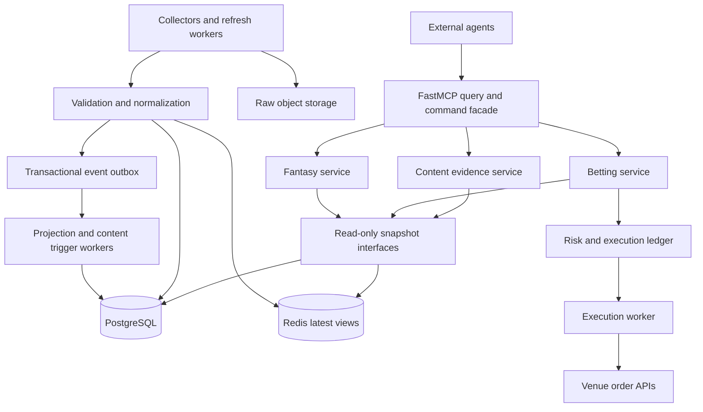

# FastMCP production architecture

## Decision

Build a **modular monolith with a centralized MCP interface and independently supervised workers**. Keep domain logic in ordinary Python services so the same code serves MCP, scheduled jobs and replay tests. Centralize identity, provenance, policy and storage; isolate continuous collectors, model jobs and order execution from interactive agent requests.

The MCP server is the agent-facing query and command plane. It should not be the high-frequency trading loop or download full NFL seasons on each request. External agents consume evidence, initiate bounded jobs and request actions. Deterministic services enforce freshness, exposure, idempotency and entitlement regardless of what an agent says.

This document specifies the target design. The root scaffold implements only the subset listed in README. Proposed directories and services below are explicitly future work unless marked **present**.

## Dependency direction and processes



Shared contracts must not import transport or adapters. Adapters translate provider payloads into domain records. Services depend on repository/provider interfaces; content depends on read interfaces, never the order executor. The composition root wires implementations. Move decorators into `betting/mcp.py`, `fantasy/mcp.py`, `content/mcp.py` when their size warrants it; register them on one server or use version-tested FastMCP composition. Avoid circular imports of the root `mcp` instance.

One worker owns each venue subscription shard using a lease/fencing token; scaling MCP replicas must not duplicate subscriptions or submitters. PostgreSQL is authoritative. Redis caches are disposable and rebuildable. Object storage holds immutable raw payloads and Parquet partitions. Start with PostgreSQL job/outbox tables; add a dedicated broker only when throughput measurements justify it.

## Target tree

```text
server.py                         # PRESENT: factory, lifespan, tools/resources, stdio
pyproject.toml                    # PRESENT: scaffold dependencies
war_room/
  contracts.py                    # PRESENT: typed boundary v1
  storage.py                      # PRESENT: temporary CSV bridge
  settings.py                     # FUTURE: validated environment configuration
  common/
    provenance.py                 # event time, ingest time, quality, lineage
    identities.py                 # sport/player/team/event ID mapping
    errors.py                     # stable errors and retryability
    telemetry.py                  # logs, traces, counters; secret redaction
    clock.py                      # UTC wall clock + monotonic duration injection
  repositories/
    protocols.py                  # snapshots, features, jobs, plans, events
    postgres.py                   # transactions and persistence
    objects.py                    # immutable raw + Parquet
    redis.py                      # hot views; no durable order state
  betting/
    service.py                    # PRESENT: hypothetical combo EV + unavailable reads
    contracts.py                  # expanded market/book/order/settlement schemas
    adapters/kalshi.py             # REST/auth/WS decoding, native combo discovery
    adapters/polymarket.py         # discovery, books, reference feeds, order auth
    discovery.py                  # rolling 15-minute market registry
    orderbooks.py                 # snapshot/delta reconciliation
    oracle.py                     # settlement source mapping and clock diagnostics
    pricing.py                    # calibrated probabilities + executable cost
    combos.py                     # native combo vs independent basket plans
    risk.py                       # reservations, limits, killswitch, suitability policy
    execution.py                  # persistent commands and reconciliation
  fantasy/
    nfl.py                        # PRESENT: worker adapter with corrected calls
    sleeper.py                    # PRESENT: public league read + bounded cache
    nhl.py                        # FUTURE: versioned provider adapter
    scoring.py                    # league-specific scoring, golden fixtures
    transforms/personas.py         # coach/scout/analytics/fantasy/GM views
    transforms/contracts.py        # normalized contract history and units
    features.py                   # point-in-time joins and feature definitions
    projections.py                # model inference and uncertainty
    models/                       # training/backtests/model registry
  content/
    service.py                    # PRESENT: bounded evidence brief
    news.py                       # normalized, deduplicated, licensed feed
    triggers.py                   # material-change events with dedupe/cooldowns
    briefs.py                     # query-relevant facts, citations, model caveats
    publishing.py                 # separate authorized adapter, later phase
  workers/
    nfl_refresh.py
    sleeper_refresh.py
    nhl_live.py
    market_streams.py
    projections.py
    outbox.py
    reconcile_orders.py
migrations/                       # versioned PostgreSQL schema
tests/                            # PRESENT: scaffold tests; expand by domain
docs/                             # PRESENT: audit, blueprint, roadmap, inventory
deploy/                           # FUTURE: containers, worker roles, health/metrics
```

Do not create empty modules for every proposed responsibility yet. The small present implementation establishes the interfaces; add modules in the dependency order in ROADMAP.

## Shared data model

Every stored observation needs `schema_version`, `source`, `source_record_id`, `source_event_at`, `received_at`, `ingested_at`, `snapshot_id`, raw payload hash, source schema version and quality flags. UTC timestamps are timezone aware. Preserve source correction/revision numbers and keep event time separate from database insertion time. Unknown timestamps stay null.

The current `Snapshot[T]` is intentionally narrower: `source_updated_at` can be null, `retrieved_at` records local read time, and legacy data is explicitly unverified. Add a new contract version for `fresh/stale/partial` views when provider collectors can actually calculate them. Never synthesize freshness from file modification time. Market execution requires a fresh validated book; content may use stale facts only with explicit age and context.

| Record / proposed key | Purpose and invariants |
| --- | --- |
| `snapshot_manifest(snapshot_id)` | Content hash, source URI, schema, coverage, row count, ingest job, quality, parent snapshots; immutable |
| `dataset_head(dataset, partition)` | Transactional pointer to a validated manifest; compare-and-swap on publish |
| `entity_map(provider, sport, provider_id, valid_from)` | Canonical identity, validity interval, resolution method/confidence; unresolved IDs quarantined |
| `nfl_player_game(season, season_type, game_id, gsis_id, revision)` | Typed observations, including team; unique grain and correction history |
| `nfl_play(game_id, play_id, revision)` | Role IDs and observed play features; joining personas uses this key |
| `nhl_player_game(season, game_id, player_id, revision)` | NHL-native season convention, position/goalie splits, game state |
| `market(venue, market_id)` | Native IDs, outcome IDs, start/end, trading status, rule version, payout currency, oracle definition |
| `book_snapshot(venue, outcome_id, generation, sequence)` | Bid/ask levels and sizes with venue-specific sequencing/checksum; no cross-generation deltas |
| `projection(model_version, entity_id, event_id, as_of, feature_snapshot_id)` | Distribution/interval, units, target, calibration and feature lineage |
| `order_intent(account_id, idempotency_key)` | Unique request hash, immutable plan, principal, risk reservation and terminal/unknown state |
| `venue_order(venue, account_id, client_order_id)` | Venue ID, fills, fees, cancellations, reconciled status |
| `news_item(source_id, source_item_id, revision)` | Source URL, published/fetched times, correction links, entities and reuse rights |
| `outbox(event_id)` / `consumer_receipt(consumer,event_id)` | Transactional event emission and idempotent consumption |

Store money and contract quantities as exact decimal values with venue tick/lot constraints. Do not collapse USD, USDC and pUSD into one unit. Store typed numeric stats; do not carry legacy strings into the model feature store. Use canonical IDs in tools while retaining provider IDs in provenance. Never resolve two same-name players by a name-only join.

## Betting pipeline

### Discovery and live order books

1. Query each venue's documented catalog and cursor pagination. Persist market metadata and full rules. Select eligible active asset markets using start/end/rules, verifying a 900-second window instead of inventing identifiers such as `BTC-15M-UP`.
2. Preload the next interval and retain the previous interval until final resolution. Track close time separately from settlement time and source observation window. A market may close early or be suspended.
3. Resolve outcome IDs and subscription identifiers through metadata. Persist exact fee schedule, tick size, lot size, payout currency, product/protocol version and oracle/rules hash.
4. Seed a local book from a documented snapshot, apply ordered deltas, and detect sequence gaps, reconnects, dropped frames and schema changes. Invalidate an inconsistent book; resnapshot before enabling executable quotes. Persist raw events for replay.
5. Publish a compact latest snapshot to Redis and a durable event/manifest to storage. Agents read bounded summaries/depth, never an entire unbounded WebSocket feed.

Kalshi's documented orderbook contains YES and NO bids; the opposite bid implies an ask through binary complement pricing. Its orderbook WebSocket emits snapshots and deltas. Preserve native precision and use the current documented authentication flow; no credentials are present in this repository. [Orderbook semantics](https://docs.kalshi.com/getting_started/orderbook_responses), [WebSocket updates](https://docs.kalshi.com/websockets/orderbook-updates).

Polymarket distinguishes event, market and outcome identifiers. Resolve those before books/orders; keep discovery, market data, wallet authentication and execution separate. The current documentation also includes protocol/SDK migrations, so pin the provider API/SDK contract and test saved payloads before choosing a client library. [Market data overview](https://docs.polymarket.com/market-data/overview).

### Oracle latency and pricing

Oracle latency is a measured property, not a probability. Match each contract to its exact resolution source, price symbol, comparison operator, strike/reference, start and final observation windows, rounding and tie rules. Two venues referencing BTC can have materially different settlement events.

Capture reference-feed source timestamps, local arrival timestamps, monotonic processing durations, sequence IDs and clock-offset estimates. Track `arrival_lag = received_at - source_timestamp` separately from `processing_lag`, `reference_age` and `book_age`. Reject impossible/future timestamps outside measured clock tolerance. Preserve late/out-of-order samples; never select a historical sample that was not available at the decision time.

For pricing, estimate `P(settlement condition | currently available features, remaining time, source rules)` using a calibrated model and replayed source publication delays. Compare that probability with executable depth-weighted cost plus fees, expected slippage and model uncertainty. For one unit paying one currency unit, provisional EV is `p - executable_cost - fees`; market midprice alone is not executable cost. No fixed latency-to-edge coefficient is justified by the current repository.

The current Polymarket guide migrates reference prices from RTDS to authenticated PolyBolt, with per-channel sequence/drop information and different symbols/payload precision. Build reference feeds behind an adapter rather than copy old RTDS examples. Verify the chosen market's actual resolution rules before treating a Chainlink or TWAP stream as its oracle. [Reference-feed migration](https://docs.polymarket.com/migrate/rtds-to-polybolt).

### Combos and order execution

Separate three concepts in the API:

| Product | Pricing | Execution semantics |
| --- | --- | --- |
| Venue-native all-legs-win combo | Explicit joint probability; actual combo quote/payout/fees | One supported native product, per venue's own lifecycle |
| Basket of independent contracts | Sum of leg EVs; portfolio covariance/tail risk still matters | Multiple orders; partial fills and leg risk |
| Cross-venue hedge | Scenario payoff table with matching settlement rules/currencies | No assumed atomicity across venues |

Do not multiply marginal win probabilities unless an explicit, validated independence model warrants it. For the current hypothetical native-combo calculator: `EV = p_joint * gross_win_payout - total_cost - unconditional_fees`. Returned stake belongs in gross payout. Real fees can depend on execution/settlement and must be modeled by the venue adapter.

Kalshi exposes multivariate collections and market creation with selected legs. Model discovery/creation and quote/RFQ steps distinctly from placing an order. Never equate a batch order request with an atomic parlay. Polymarket product availability must likewise be discovered and validated rather than assumed from arbitrary legs. [Kalshi multivariate creation](https://docs.kalshi.com/api-reference/multivariate/create-market-in-multivariate-event-collection).

The future action lifecycle is:

```text
propose plan -> price/validate -> reserve exposure -> authorize under account policy
 -> submit -> acknowledge -> partial fills / filled / cancel requested
 -> reconcile -> settled or terminal
```

Persist `unknown` after a timeout that may have reached the venue. Query by client order ID / native order identity before any retry. A successful cancel request does not prove no late fills. The ledger must account for fees, pending orders, available funds and filled positions through restart. Key idempotency by principal/account/key and payload hash; reject reuse with different payloads.

`execute_combo_bet(ComboExecution)` currently always fails closed. Before implementing it, resolve `plan_id` to a server-owned immutable plan with quote snapshot IDs, expiry, allowed venues, exact legs, principal and risk reservation. Enforce max cost, per-market/event/asset exposure, correlated exposure, stale-book/clock limits and a kill switch in the execution service. Treat `expires_at` supplied by a client as an additional limit, never an extension of server quote validity. Reserve funds and write an outbox command in one database transaction.

## Fantasy and statistics pipeline

### NFL and Sleeper

Use `nflreadpy` for published NFL datasets and backfills. Its presence does not establish a tick-by-tick live feed. Use a separately contracted provider if the required NFL freshness exceeds upstream publication cadence. Retain `nflreadpy==0.1.5` during the first migration and test version upgrades independently.

1. `workers/nfl_refresh.py` accepts explicit seasons and dataset names. Load Polars frames directly; avoid the intermediate pandas copy. Validate expected schema and coverage before publication.
2. Publish player-game, team-game, PBP, schedules, players and ID crosswalk dimensions. Store immutable raw data plus normalized Parquet. Derive the five persona views from one coherent manifest set.
3. Recreate coach columns and day-of-week enrichment, regenerate analytics EPA/WPA/CPOE/success, add separate NGS passing/rushing/receiving datasets, and normalize GM contracts. Do not double-count NGS week 0 season summaries.
4. Preserve GSIS player IDs, season/season_type, game IDs, team and week before selecting display columns. Add Sleeper IDs via crosswalks, quarantine ambiguity and version mappings.
5. Fetch Sleeper league settings, rosters, matchups and transactions using documented endpoints. Cache the player dictionary centrally and fetch it no more frequently than daily as its docs request. Sleeper league APIs document NFL support; do not route NHL through that path. [Sleeper API](https://docs.sleeper.com/).
6. Apply versioned league scoring to normalized player-game stats. Port the original yardage/TD/interception/fumble coefficients, add reception scoring, bonuses, two-point plays, defensive/kicking rules as configured, and test against known league totals. Missing scoring fields are not automatically zero.

The new worker-only adapter uses `summary_level="week"` for player stats and explicit `stat_type` for NGS. Configure caching once through `NFLREADPY_CACHE`, `NFLREADPY_CACHE_DIR`, `NFLREADPY_CACHE_DURATION` and timeout settings; never mutate global cache config per simultaneous request. [nflreadpy configuration](https://nflreadpy.nflverse.com/api/configuration/).

### NHL

Create an independent `NHLProvider` interface for schedule, boxscore, PBP, roster, injuries/availability and goalie starts. Candidate discovery endpoints include `api-web.nhle.com/v1/schedule/now` and `api.nhle.com/stats/rest/en/...`; this run could not verify them through the web tool. Treat their schemas, access terms and live reliability as an explicit integration spike, not a production guarantee. Obtain a supported provider with an appropriate SLA if official public endpoints do not meet the requirement.

Keep NHL season identifiers, overtime/shootout rules, shifts, time-on-ice, strength state, goalie metrics and postponement handling sport-specific. Convert time-on-ice to seconds with explicit units. Start features with shots, attempts, power-play share, line/goalie availability, rest/travel and opponent strength. Do not equate unavailable tracking data with zero or label basic boxscore metrics as tracking-derived next-gen stats.

### Predictive modeling

Start with reproducible baselines: rolling role-adjusted NFL usage/efficiency and NHL shots/ice-time models. Define the target and horizon for every prediction. Train on chronological splits; keep future injuries, closing odds and corrected data unavailable until their historical receipt times. Score calibration with Brier/log loss for probabilities and MAE/interval coverage for numeric projections. Compare against a naive rolling baseline and record sample size, drift and uncertainty.

The model registry stores artifact hash, code version, data manifests, features, training cutoff, validation results and promotion status. Inference produces quantiles/distributions as well as a point estimate; attach model and feature versions. Betting may consume projections through a read interface only after mapping the model target to the market settlement definition. A fantasy point mean cannot directly price a yards prop or a win probability.

## Content, news and agent triggers

The server prepares evidence; the external writing agent generates prose. Facts, predictions and venue prices remain distinct typed inputs with source links and as-of timestamps. This avoids coupling the server to an LLM vendor and keeps content generation from blocking collectors.

News ingestion needs licensed/allowed feeds, canonical URLs, source attribution, published and fetched times, entity resolution, duplicate detection, corrections and provenance. Treat story bodies, social text and market descriptions as untrusted data. Provider URLs are configured server-side; agents do not supply arbitrary fetch URLs. Avoid republishing full source text when only excerpts/attribution are allowed.

Emit durable events such as `projection.updated`, `news.corrected`, `market.price_moved` and `player.availability_changed` only after validated state changes. Use an outbox with consumer checkpoints, debounce/cooldowns and stable dedupe keys `(entity, event_type, rule_version, source_revision)`. Agents poll a bounded cursor feed or receive a signed webhook through a separately configured dispatcher. MCP resource reads are snapshots, not perpetual streams; resource-update notifications, where supported, are invalidation hints followed by a reread. [FastMCP resources](https://gofastmcp.com/servers/resources).

The present `prepare_content_brief` returns a persona sample, not semantic search, current news or generated prose. Next replace the sample with relevant, joined facts from a coherent manifest and return required citations, freshness limitations and approved formats. Publishing is a separate side effect with destination-scoped credentials, idempotency and an explicit publication policy.

## Tool and resource contract

The exact current Python definitions are in `war_room/contracts.py`; decorators and composition are in root `server.py`. Pydantic validation forbids unknown fields, rejects nonfinite numbers, bounds pages and accepts exact decimal strings. Annotations describe behavior to clients; they are not authorization controls. [FastMCP tools](https://gofastmcp.com/servers/tools).

| Current interface | Input / output | Current state |
| --- | --- | --- |
| `query_nfl_snapshot` | `DatasetQuery -> Snapshot[DatasetPage]` | Real CSV bridge |
| `get_sleeper_league` | bounded numeric league ID -> `Snapshot[League]` | Real HTTP adapter; fixture-tested |
| `get_live_markets` | `MarketQuery -> Snapshot[list[MarketQuote]]` | Explicit unavailable |
| `evaluate_combo_bet` | `ComboScenario -> ComboEvaluation` | Real hypothetical arithmetic |
| `execute_combo_bet` | `ComboExecution -> ExecutionReceipt` | MCP error; never submits |
| `prepare_content_brief` | `ContentRequest -> ContentBrief` | Real bounded evidence |
| `warroom://status` | capability dictionary | Development status |
| `fantasy://datasets` | `Snapshot[list[DatasetInfo]]` | Real local catalog |
| `fantasy://stats/nfl/{dataset}/{week}` | `Snapshot[DatasetPage]` | First 25 matching rows |
| `fantasy://projections/{sport}/{player_id}` | `Snapshot[Projection]` | Explicit unavailable |
| `betting://markets/{venue}/{asset}` | `Snapshot[list[MarketQuote]]` | Explicit unavailable |
| `betting://oracle/{venue}/{market_id}` | `Snapshot[OracleObservation]` | Explicit unavailable |
| `news://latest` | `Snapshot[list[NewsItem]]` | Explicit unavailable |

Future executable tools: `request_refresh` returns a durable job ID; `get_job` returns state; `price_combo` returns a persisted expiring plan; `cancel_order` and `get_order` operate on authorized account IDs; `poll_events` returns a bounded cursor page. Future projection queries must specify event/horizon and scoring version rather than silently infer them from player ID. Keep these unregistered until they have real services and authorization.

## Deployment and operations

Use stdio for the local scaffold. Production exposes Streamable HTTP behind TLS with validated OAuth/JWT issuer, audience and scopes. Implement service-level authorization for read, refresh, trading and publishing; bind principals to allowed accounts/leagues and audit every write. Keep API keys and private signing material in a secrets service available only to their worker roles. Configure host/origin protection, trusted proxies, request limits and per-principal quotas. [FastMCP HTTP deployment](https://gofastmcp.com/deployment/http).

The lifespan owns shared HTTP pools, repository connections and graceful cleanup. Long jobs run in workers, not within request timeouts or each replica's lifespan. Use explicit worker health and lease heartbeats. Support graceful shutdown with draining and unacknowledged outbox replay.

Proposed initial engineering targets, to validate under load: cached query p95 below 250 ms; market collector processing lag p95 below 250 ms; market book older than 2 seconds rejected for execution; 60-second normal league cache; daily bulk player identity refresh. These are internal starting policies, not guarantees about external sources. Set feed-specific freshness thresholds using measured provider cadence and market duration; low-cadence reference feeds require their own age rules.

Instrument tool latency/error rate, provider 429s, retries, reconnects, sequence gaps, source age, schema quarantine, outbox backlog, projection drift, and orders stuck unknown. Readiness reports partial provider failures without inventing overall health. Logs go to stderr for stdio and redact secrets. Store traces linking tool call -> plan -> reservation -> venue order -> fills.

Release gates: fixture contract tests; correction/reconnect replays; repeated-command and concurrency tests; temporal-leakage checks; exact financial arithmetic; deployment auth tests; load/soak tests; backup restoration; paper/demo execution and restart reconciliation. The present tests cover the scaffold only. There is no claim that those larger production gates have passed.
